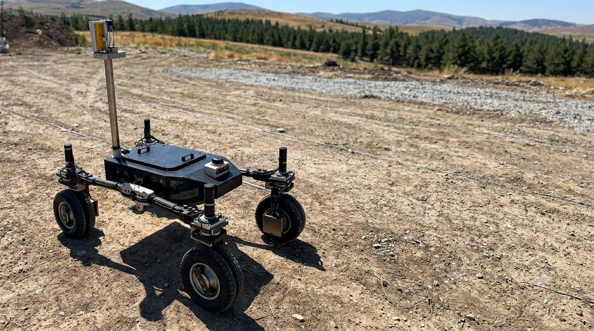
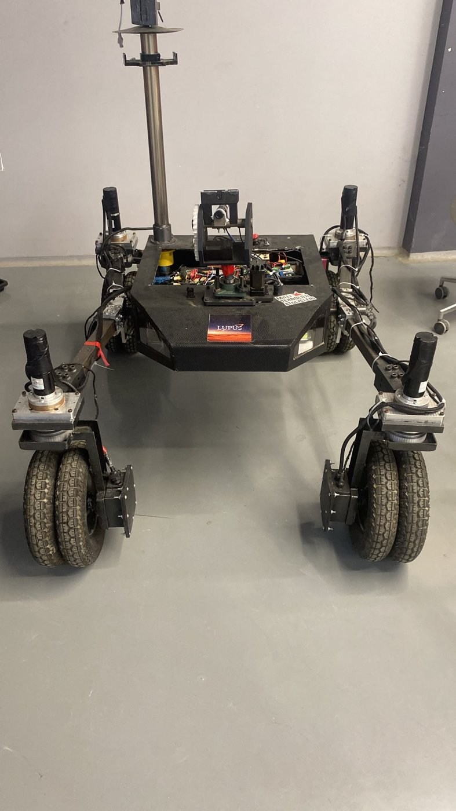
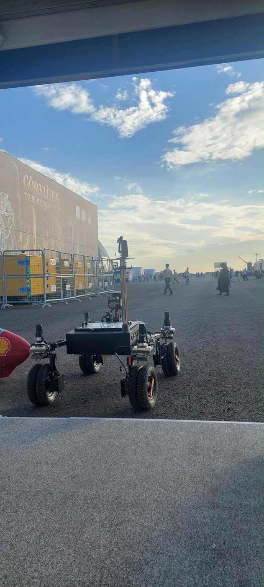
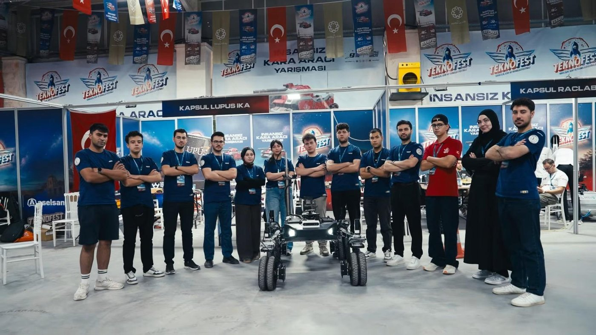

# Elektronik Projeler — Mustafa Emir Yumrukaya

Selçuk Üniversitesi Elektrik-Elektronik Mühendisliği 4. sınıf öğrencisiyim. Lupus Rover Team'in elektronik takım kaptanıyım. Bu repoda güç elektroniği ve gömülü sistemler projelerimin kodları, şemaları, PCB'leri ve ölçüm sonuçları duruyor.

  
  

*Lupus rover: üstte takımın test parkurunda; altta atölyede ve TEKNOFEST 2026 alanında.*

*Lupus Rover Team, TEKNOFEST 2026 İnsansız Kara Aracı Yarışması.*

*Hardware & embedded projects: motor drivers, a multi-output DC-DC power board, rover battery packs, a rover CAN bus and a hexacopter build. Docs are in Turkish; code comments are mostly Turkish.*

| Proje | Durum | İçerik |
|---|---|---|
| [STM32 Enkoderli Motor Sürücü](stm32-enkoderli-motor-surucu/) — bitirme projesi | Çalışıyor, videolu | STM32F103 (HAL) firmware, PI + ileri besleme hız kontrolü, IR2103'lü tam H-köprü, osiloskop ölçümleri |
| [H-Köprü DC Motor Sürücü](h-kopru-motor-surucu/) — ders projesi, 2 kişilik ekip | Çalışır prototip | 24 V / 10 A P-N köprü, KiCad şema ve PCB, Arduino kodu |
| [Lupus Buck-V1](lupus-buck-v1/) — rover güç kartı | Üretim öncesi | 24 / 12 / 5 V çıkışlı güç kartı, KiCad şema ve PCB, tasarım hesapları, LTspice sonuçları |
| [Lupus Rover Bataryaları](lupus-bataryalar/) — takım arkadaşımla | Araçta kullanılıyor | 12S8P (36 Ah, 21700) ve 7S7P (18,2 Ah, 18650) Li-ion paketler, Daly BMS, CAN üzerinden izleme |
| [Lupus Rover CAN Haberleşmesi](lupus-rover-can/) | Araçta çalışıyor | Here4 GPS, Daly BMS, ODrive, STM32, ESP32 ve Jetson Orin'li 250 kbit/s CAN hattı; ESP32 ana düğüm kodu, mesaj tablosu, DroneCAN kütüphane yaması |
| [Lupus İHA](lupus-iha/) — 6 motorlu heksakopter | Uçtu, videolu | Orange Cube, ArduPilot, Mission Planner; elektronik montaj, kalibrasyon, Stabilize ve Loiter uçuşları |

Klasörlerin yapısı: `README.md` (projenin özeti ve sonuçları), `firmware/` (kod), `hardware/` (şema ve PCB, varsa) ve `images/` (fotoğraflar, ölçümler).

Tüm projelerin özeti tek dosyada: [Proje portfolyosu (PDF)](Mustafa_Emir_Yumrukaya_Portfolyo.pdf)

İletişim: memiryumrukaya@gmail.com · [LinkedIn](https://www.linkedin.com/in/emir-yumrukaya)
