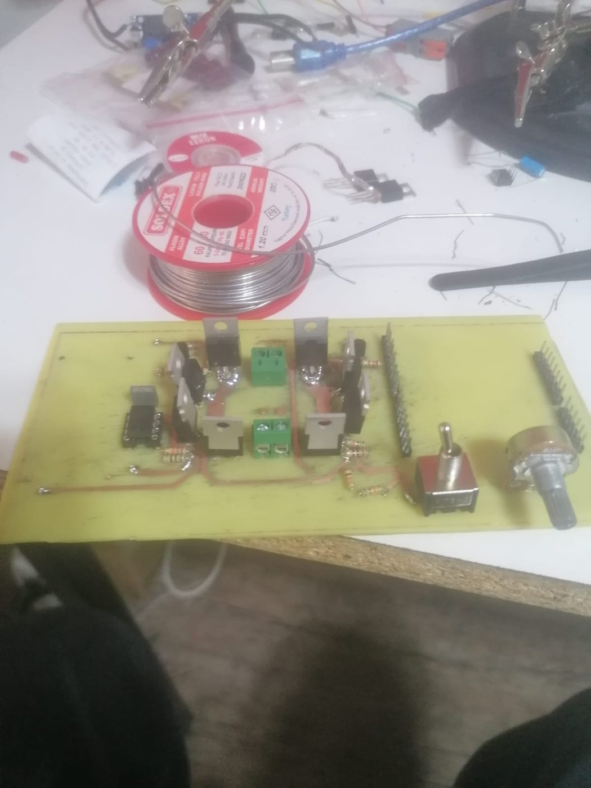
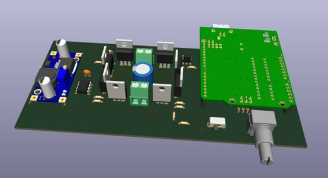
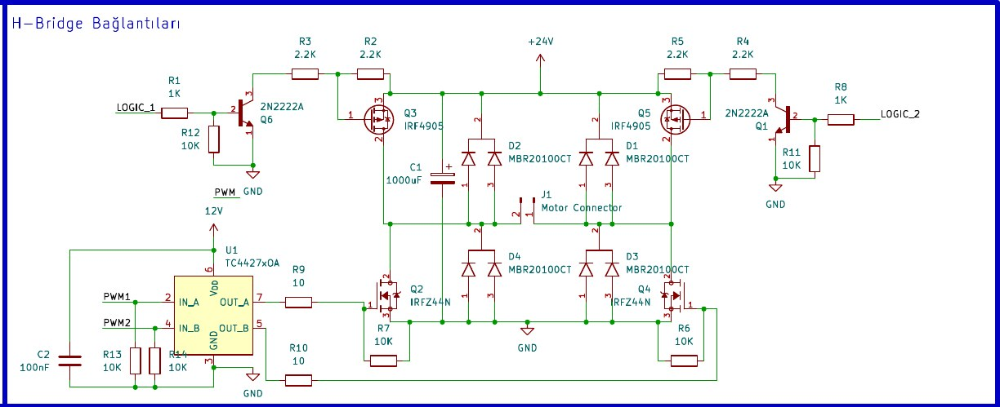

# H-Köprü DC Motor Sürücü Kartı (24 V / 10 A)

**Durum:** Çalışır prototip · Elektronik Devre Tasarımı dersi · 2 kişilik ekip (tasarım ve üretimin büyük bölümü bende) · Fakülte sempozyumunda sunuldu

240 W, 24 V fırçalı DC motoru Arduino Uno ile süren kart. Hız potansiyometreyle, yön anahtarla seçiliyor.

  
  

## Tasarımın gelişimi
1. **Tasarım 1 · N-N köprü (sempozyum sürümü):** 4× IRFZ44N, IR2104 kapı sürücüleri, bootstrap ile üst taraf. Breadboard denemelerinde üst taraf sürülemedi ve IR2104'ler yandı.
2. **Tasarım 2 · P-N köprü (son hâl):**
   - Üst taraf: IRF4905 P-MOSFET'ler. 2N2222 ve 2,2 kΩ + 2,2 kΩ bölücüyle sürülüyor, böylece Vgs ≈ −12 V (±20 V sınırının içinde).
   - Alt taraf: IRFZ44N, TC4427 kapı sürücüsüyle PWM.
   - MBR20100CT Schottky serbest dolaşım diyotları, 1000 µF bara kondansatörü, LM2596 ile 24 V → 12 V.

## Kontrol ([`firmware/motor_surucu.ino`](firmware/motor_surucu.ino))
- Üst taraf yalnızca yön için aç/kapa; PWM alt taraftan veriliyor.
- Hız rampası: normal çalışmada PWM adımı başına 20 ms; yön değişiminde frenleme rampası adım başına 3 ms.
- Yön değişiminde önce rampayla durma, sonra 2 s güvenlik beklemesi, ardından yeni yönde hızlanma.
- Potansiyometrede gürültü eşiği (ölü bölge): PWM < 10 ise 0.

## Dosyalar
- [`hardware/sema.pdf`](hardware/sema.pdf): KiCad şeması
- [`hardware/pcb.pdf`](hardware/pcb.pdf): PCB yerleşimi
- PCB'yi kendimiz ürettik (aşındırma ve delme): [`images/pcb_asindirma.jpg`](images/pcb_asindirma.jpg)
