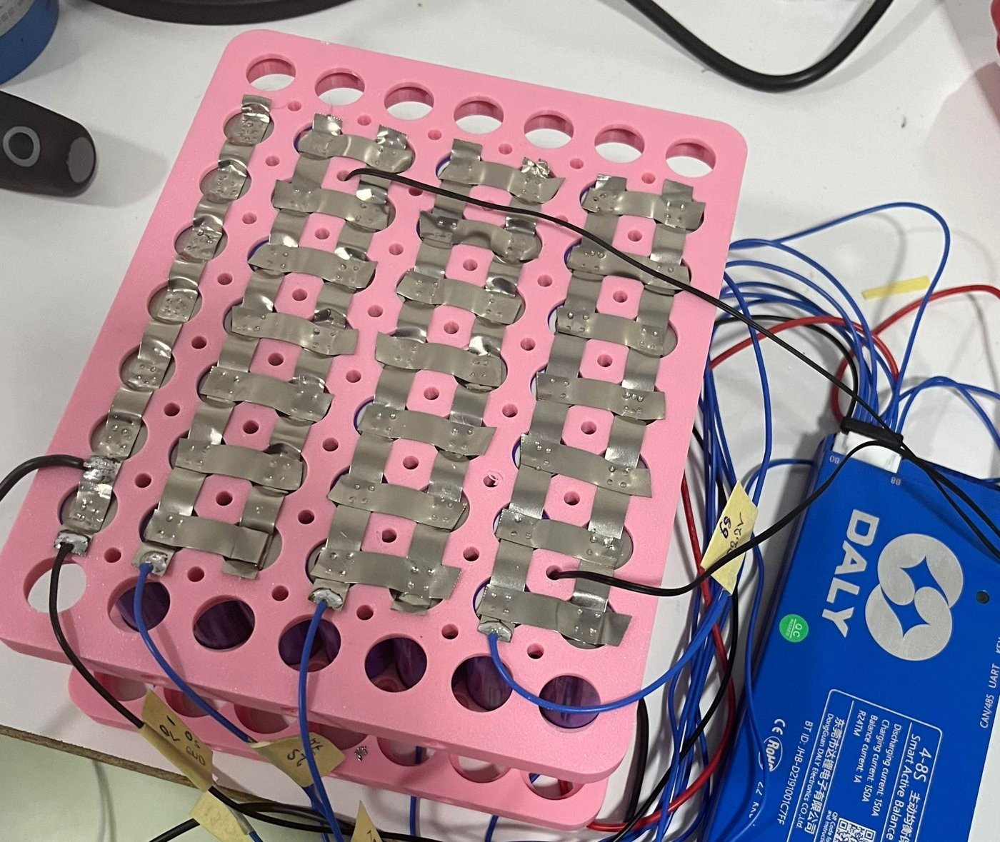
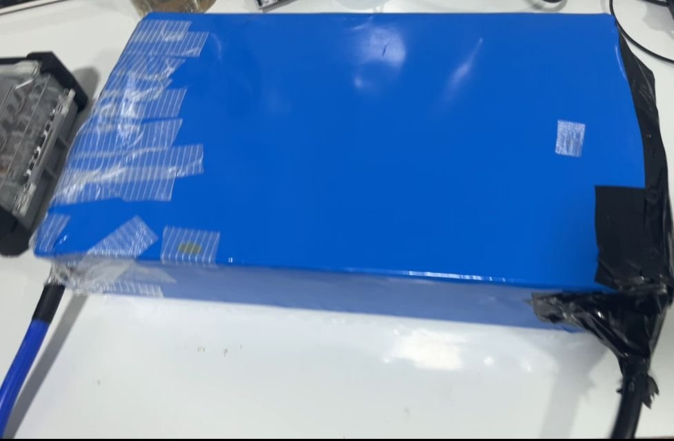
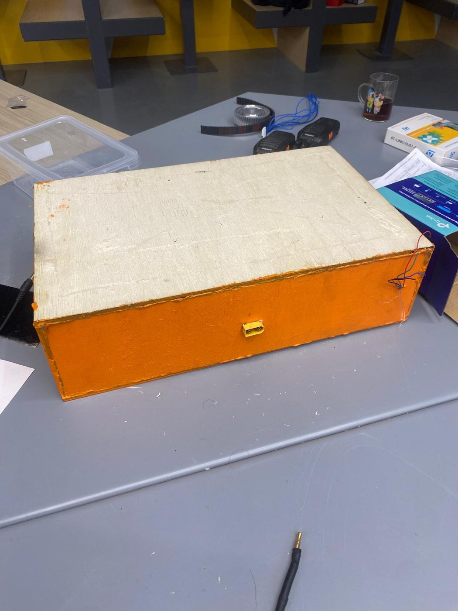
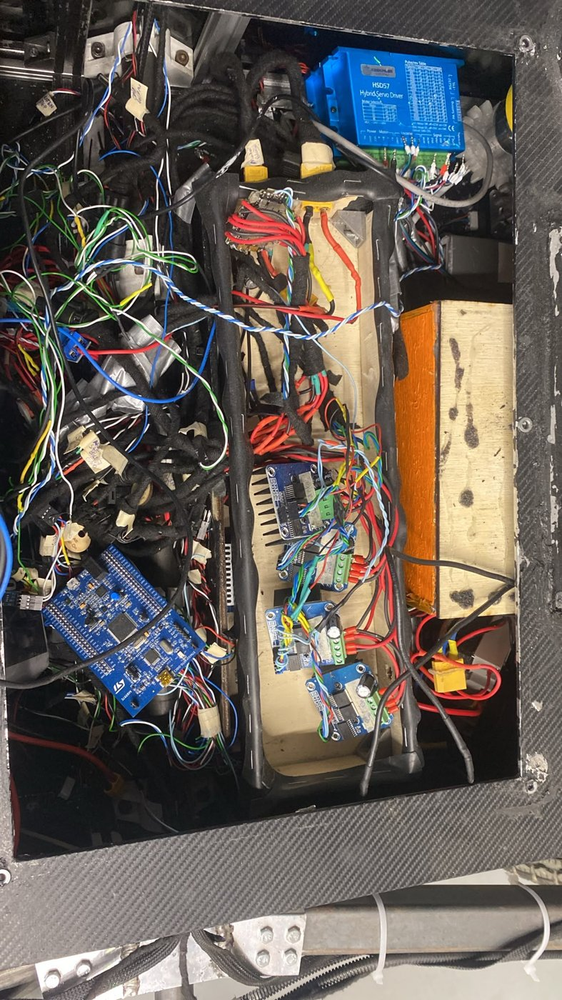

# Lupus Rover Batarya Paketleri (12S8P ve 7S7P)

**Durum:** Araçta kullanılıyor · Lupus Rover Team · 2026 · Takım arkadaşım Can ile birlikte ürettik

Rover için iki Li-ion paket ürettik. Hücreleri punta kaynağıyla nikel şeritlerle bağladık. Her pakette bir Daly R24TM serisi (150 A) akıllı BMS var; iki paketin çıkışı da XT90. İki paket de farklı boyutlarda turuncu ahşap kutulara yerleştirildi; 7S paket araç gövdesinin içinde, daha büyük olan 12S paket dışarıda duruyor.

| | 12S8P paket | 7S7P paket |
|---|---|---|
| Hücre | DMEGC 21700, 4500 mAh, 3C · 96 adet | INR18650-M26S, 2600 mAh, 3C · 49 adet |
| Gerilim aralığı (3,0–4,2 V/hücre) | 36–50,4 V (nominal 43,2 V) | 21–29,4 V (nominal 25,2 V) |
| Kapasite | 36 Ah (≈ 1,56 kWh) | 18,2 Ah (≈ 0,46 kWh) |
| Sürekli deşarj (hücre 3C) | ≈ 108 A | ≈ 55 A |
| BMS | Daly R24TM, 150 A | Daly R24TM, 150 A |

*Nominal gerilim ve enerji, hücre başına 3,6 V nominal alınarak hesaplandı.*

## BMS ayarları
- Hücre başı alt sınır 3,0 V, üst sınır 4,2 V
- Sıcaklık sınırı 45 °C
- BMS, rover'ın CAN hattında; ana ESP32 gerilim, akım ve şarj durumunu (SOC) 200 ms'de bir okuyup Jetson Orin'e iletiyor. Ayrıntı: [CAN haberleşmesi](../lupus-rover-can/)

## Fotoğraflar
| | |
|---|---|
|  7S paketin montajı: hücre tutucular, punta kaynaklı nikel şeritler, denge kabloları ve Daly BMS |  12S paket, makaronla kaplanmış hâli |
|  12S paket kutusunda, XT90 çıkışı ortada |  7S paket araçta: sağdaki turuncu kutu, XT90 çıkışı sağ tarafta |
