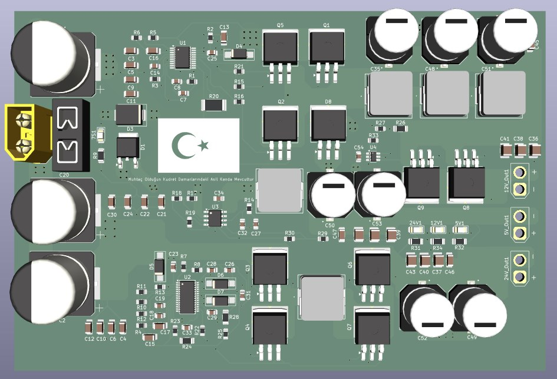
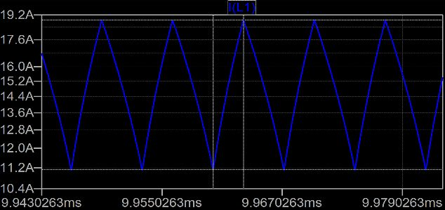
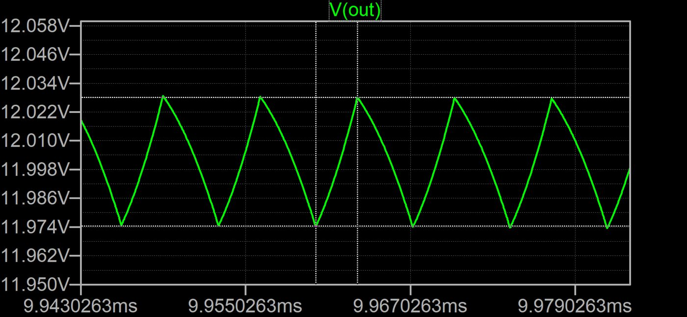
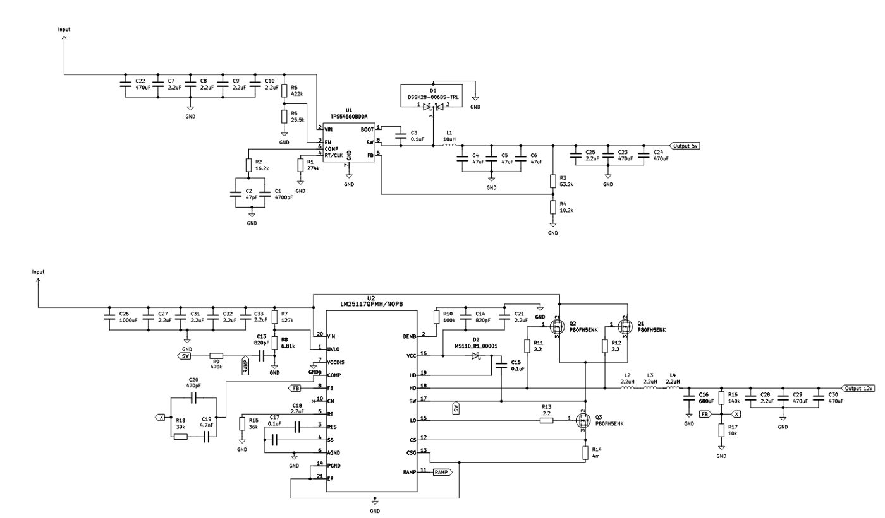

# Lupus Buck-V1 — 3 Çıkışlı Güç Yönetim Kartı

**Durum:** Üretim öncesi (tasarım, hesap ve simülasyon tamam; kart henüz üretilmedi) · Lupus Rover Team · 2026

Rover'ın 7S Li-ion paketinden (20–29,4 V) aracın elektronik alt sistemlerini besleyen kart.

| Hat | Kontrolcü | Topoloji | Akım | Anahtarlama | Beslediği yükler |
|---|---|---|---|---|---|
| 24 V | LM5175 | Buck-boost | 6 A | 300 kHz | CPE510 telsiz bağlantısının PoE switch'i |
| 12 V | LM25117 | Senkron buck | 15 A | 248 kHz | Jetson Orin NX (üzerinden RPLIDAR S2, 3× Logitech C922, ZED 2i), 2× 150 kg servo motor |
| 5 V | TPS54560 | Asenkron buck | 5 A | 507 kHz | ESP32, STM32 Discovery, Here4 GPS, enkoder beslemeleri |

Üç hattın anahtarlama frekansları, harmoniklerin çakışmaması için birbirinden ayrık seçildi.

## 12 V hattı hesapları
- RT = 20 kΩ → anahtarlama frekansı ≈ 248 kHz
- İndüktans 6,6 µH → akım dalgalanması ≈ 4,3 A, tepe akım ≈ 17,2 A
- Şönt direnç 5 mΩ, kayıp ≈ 0,67 W
- Çıkış kapasitesi 1083 µF → hesaplanan çıkış dalgalanması ≈ 43 mV
- UVLO eşiği 22,4 V

## LTspice (~15 A yük)
| İndüktör akımı | Çıkış gerilimi |
|---|---|
|  |  |
| ≈ 11,2–19 A üçgen dalga | ≈ 11,974–12,022 V, ~50 mV tepe-tepe |

