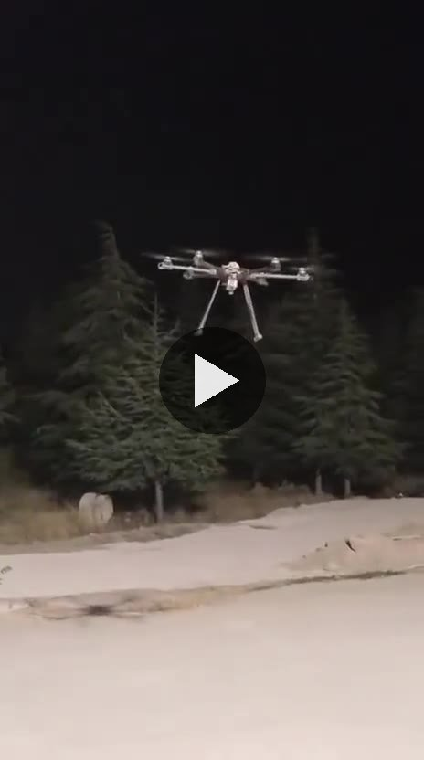

# Lupus İHA — 6 Motorlu Heksakopter

**Durum:** Uçtu (Stabilize ve Loiter modları) · Lupus Rover Team

Takım için hazır bileşenlerden toplanan 6 motorlu bir İHA (heksakopter).

## Benim yaptıklarım
- Elektroniğin tamamını topladım ve bağladım: Orange Cube uçuş kontrolcüsü, ESC'ler, motorlar, kumanda alıcısı.
- ArduPilot'u Mission Planner ile kurdum. ESC, kumanda ve sensör kalibrasyonlarını yaptım.
- Aracı Stabilize ve Loiter (GPS ile konum tutma) modlarında uçurduk.

## Uçuş videosu (sessiz, 81 s)

[`video/ucus.mp4`](video/ucus.mp4): gece uçuşu, aracın yerden kalkıp havada konum tutması.
