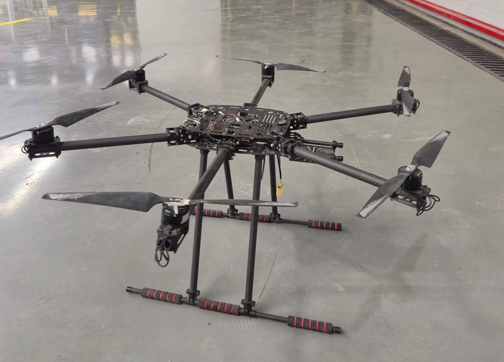

# Lupus İHA — 6 Motorlu Heksakopter

**Durum:** Uçtu (Stabilize ve Loiter modları) · Lupus Rover Team

Takım için hazır bileşenlerden toplanan 6 motorlu bir İHA (heksakopter).

## Benim yaptıklarım
- Elektroniğin tamamını topladım ve bağladım: Orange Cube uçuş kontrolcüsü, ESC'ler, motorlar, kumanda alıcısı.
- ArduPilot'u Mission Planner ile kurdum. ESC, kumanda ve sensör kalibrasyonlarını yaptım.
- Aracı pilot kontrolünde, Stabilize ve Loiter (Here4 GPS ile konum tutma) modlarında uçurduk.

## Donanım
| Parça | Model |
|---|---|
| Uçuş kontrolcüsü | Orange Cube (ArduPilot) |
| GPS | Here4 |
| ESC | Hobbywing XRotor 40A × 6 |
| Motor | SunnySky X3510S 380 KV × 6 |
| Batarya | 6S, 8000 mAh |
| Yer istasyonu | Mission Planner (kurulum ve kalibrasyon) |

## Uçuş videosu (sessiz, 81 s)

[`video/ucus.mp4`](video/ucus.mp4): gece uçuşu, araç alçak irtifada uçuyor ve konum tutuyor.
