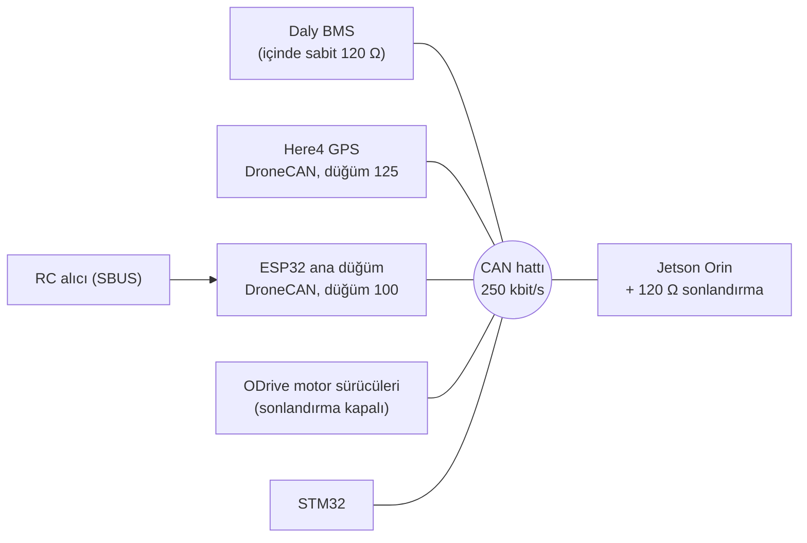

# Lupus Rover — CAN Haberleşmesi

**Durum:** Araçta çalışıyor · Lupus Rover Team · 2026

Rover'daki GPS, batarya yönetim sistemi (BMS), motor sürücüleri, mikrodenetleyiciler ve Jetson Orin tek bir CAN hattını paylaşıyor. Hattı ben kurdum; bu klasördeki ESP32 yazılımlarını ben yazdım.

## Hat yapısı

## Sorun → çözüm
**Sonlandırma.** Daly BMS'in içinde kapatılamayan bir 120 Ω direnç var, ODrive'ların da kendi sonlandırma dirençleri açıktı. Hattın iki ucunda tam iki 120 Ω olacak şekilde ODrive'ların sonlandırmalarını kapattım ve hattın diğer ucuna, Orin tarafına 120 Ω ekledim. Güç kapalıyken CAN_H–CAN_L arasında ~60 Ω ölçülüyor.

**Bus-off.** Düğümler farklı hızlarda konfigüre edildiğinde hat bus-off'a düşüyordu. BMS yalnızca 250 kbit/s ile çalıştığı için tüm düğümleri 250 kbit/s'ye çektim.

**DroneCAN ile ham CAN'ı aynı denetleyicide okumak.** Here4 DroneCAN konuşuyor, BMS ve Orin ise ham CAN çerçeveleri kullanıyor. Kullandığım [DroneCAN_ESP32](https://github.com/dukang1996/DroneCAN_ESP32) kütüphanesi okuduğu çerçeveleri yalnızca DroneCAN çözücüsüne veriyordu ve standart (11 bit) ID'leri doğru aktarmıyordu. Kütüphaneye ham çerçeve geri çağrısı (`setRawFrameCallback`) ekledim ve standart ID'leri düzelttim. Böylece tek ESP32 hem GPS'i hem BMS'i hem Orin'i dinleyebiliyor. Değişiklik: [`kutuphane_yamasi/DroneCAN_ESP32_ham_frame.patch`](kutuphane_yamasi/DroneCAN_ESP32_ham_frame.patch).

## Mesajlar

| ID | Yön | Tür | İçerik | Periyot |
|---|---|---|---|---|
| `0x18900140` | ESP32 → BMS | 29 bit | Daly sorgusu (8 bayt sıfır) | 200 ms |
| `0x18904001` | BMS → ESP32 | 29 bit | Gerilim (B0–1, ×0,1 V), akım (B4–5, (x − 30000) × 0,1 A), SOC (B6–7, ×0,1 %) | sorguya cevap |
| DroneCAN 1063 (`gnss.Fix2`) | Here4 → ESP32 | DroneCAN | Enlem, boylam, uydu sayısı, fix durumu | Here4'ün hızı |
| DroneCAN `LightsCommand`, `param.GetSet` | ESP32 → Here4 | DroneCAN | LED rengini fix/uydu sayısına göre ayarlama (`NTF_LED_OVERRIDE`) | 500 ms |
| `0x500` | ESP32 → Orin | 11 bit | Enlem, boylam (int32, ×1e7) | 100 ms |
| `0x501` | ESP32 → Orin | 11 bit | GPS fix durumu | 100 ms |
| `0x502` | ESP32 → Orin | 11 bit | BMS özeti: gerilim, akım, SOC (×10) | 100 ms |
| `0x503` | ESP32 → Orin | 11 bit | Durum baytı: bit0 acil durdurma, bit2 SBUS anahtarı, bit3 SBUS kopması, bit4 otonom mod, bit5 taret modu | 50 ms |
| `0x21` | Orin → ESP32 | 11 bit | Otonom modda taret pan/tilt hızı (int16 ×1e-4) ve lazer tetiği | Orin'in hızı |
| `0x22` | Orin → ESP32 | 11 bit | Araç yönü (int16, ×0,1°), anten takibi için | Orin'in hızı |

## Güvenlik
- Acil durdurma her döngüde yeniden hesaplanıyor: SBUS'taki acil durdurma anahtarı, SBUS failsafe biti ya da 50 ms boyunca yeni SBUS çerçevesi gelmemesi durdurmayı tetikliyor.
- Açılışta acil durdurma aktif kabul ediliyor; ilk geçerli SBUS okumasına kadar hareket yok.
- Orin'den gelen komutlar zaman aşımlı: `0x21` 300 ms, `0x22` 500 ms gelmezse ilgili hareket duruyor.

## Dosyalar
| Klasör | Ne yapıyor |
|---|---|
| [`firmware/rover_ana_dugum/`](firmware/rover_ana_dugum/) | Ana ESP32 düğümünün Eylül 2026 tarihli ara sürümü. Here4 ve BMS'i okuyup Orin'e özet gönderiyor; SBUS'tan acil durdurma ve mod seçimi; taret ve anten step motorları; BNO055 ile anten yön takibi. |
| [`firmware/bms_okuma/`](firmware/bms_okuma/) | Daly BMS'i tek başına sorgulayıp JSON basan test kodu. |
| [`firmware/can_dinleyici/`](firmware/can_dinleyici/) | Hattaki tüm çerçeveleri filtresiz basan dinleyici; düğüm ID'lerini ve DroneCAN mesaj türlerini görmek için kullandım. |
| [`kutuphane_yamasi/`](kutuphane_yamasi/) | DroneCAN_ESP32 kütüphanesine yaptığım değişiklik. |

Araçta çalışan son sürüm (ince ve kaba step kontrolü ile özel hassasiyet ayarı eklenmiş hâli) ile Orin tarafındaki köprü programı (`can_bridge.cpp`) başka bilgisayarlarda kaldığı için henüz bu repoda yok; bulununca eklenecek.

**Gerekli kütüphaneler (Arduino IDE):** DroneCAN_ESP32 (yamalı), ACAN_ESP32, Bolder Flight Systems SBUS, Adafruit BNO055, Adafruit Unified Sensor; test kodları için ESP32-TWAI-CAN.
