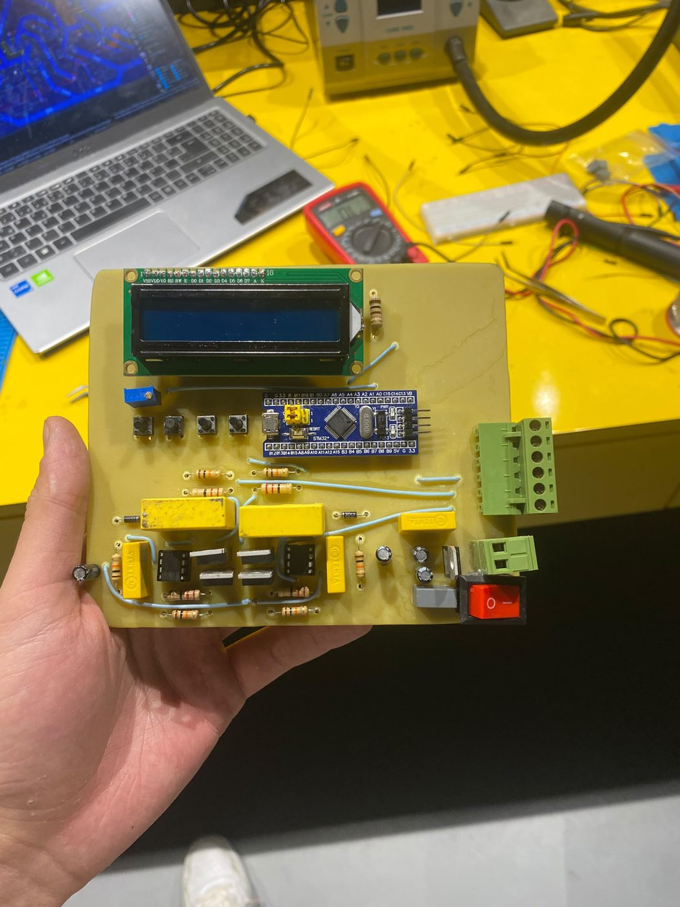
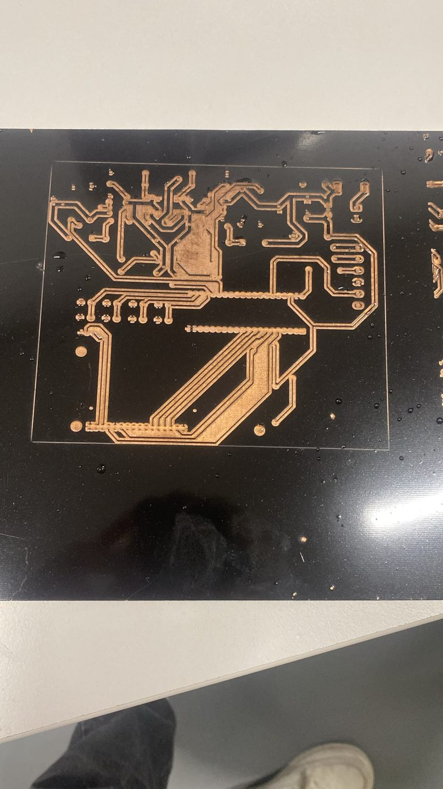
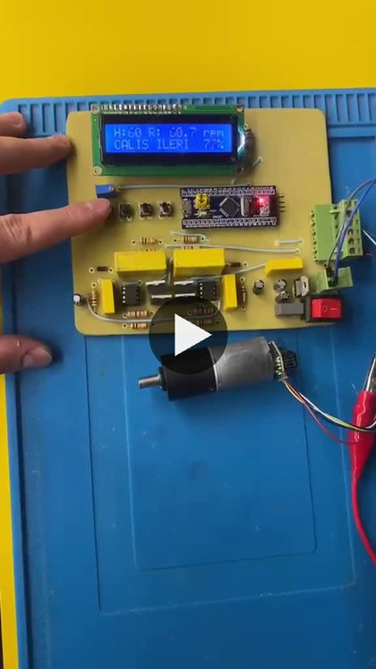
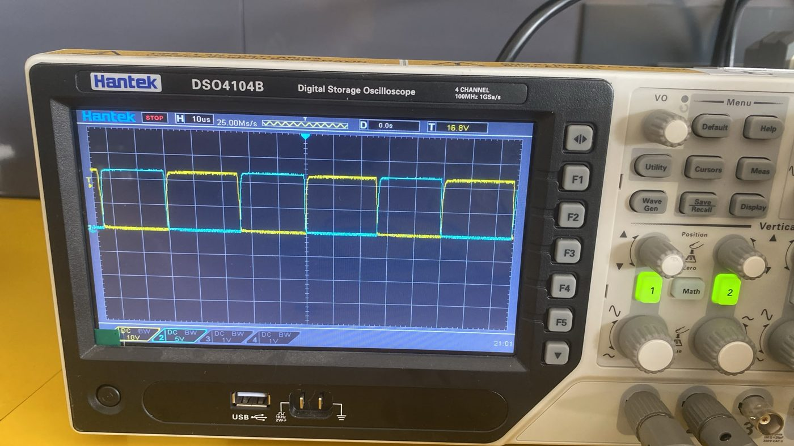
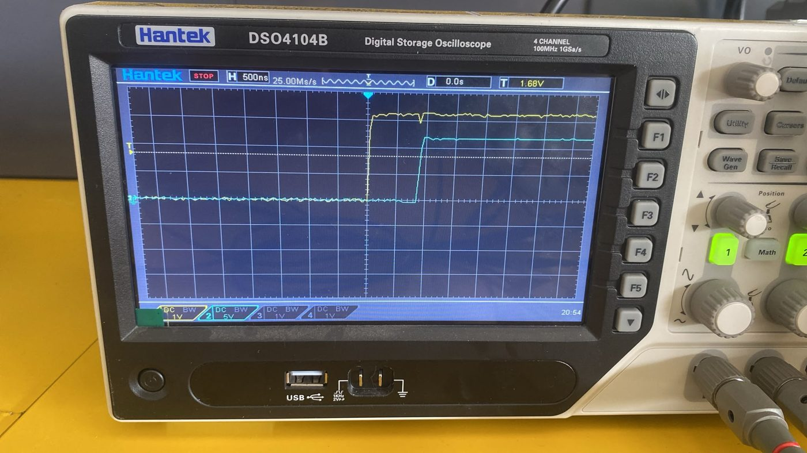
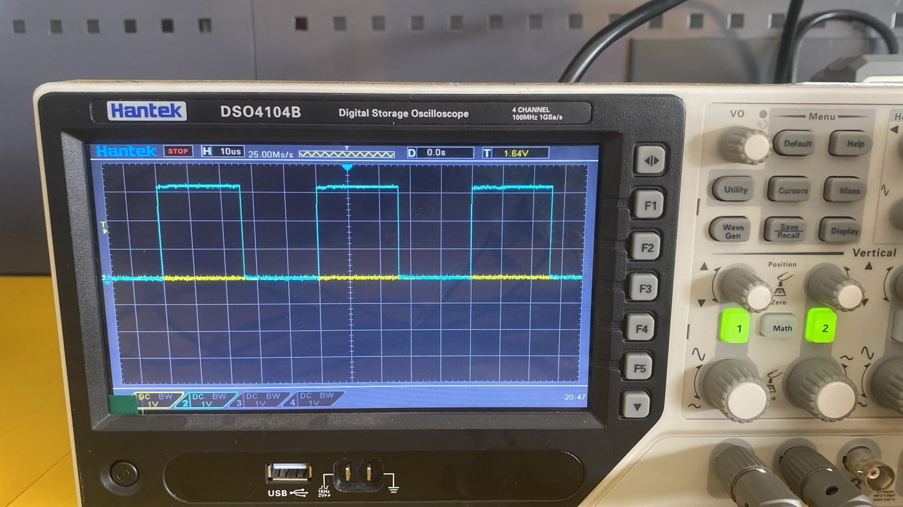
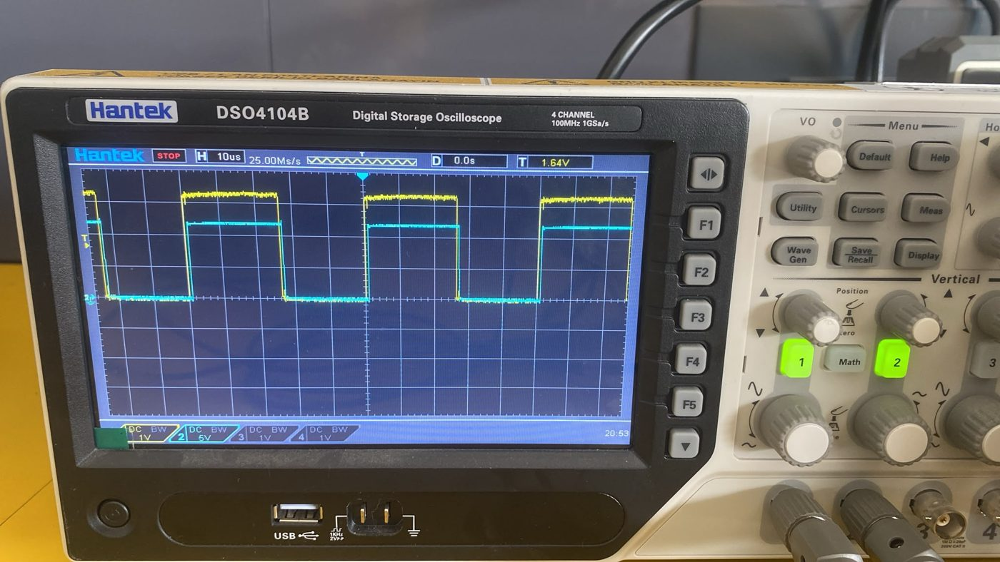

# STM32 Tabanlı Enkoderli DC Motor Sürücüsü (Bitirme Projesi)

**Durum:** Çalışıyor · 2026

[Motorobit 12 V enkoderli DC motorun](https://www.motorobit.com/12v-encoderli-dc-motor) hızını kapalı çevrimde kontrol eden sürücü. Hedef rpm LCD ve butonlarla giriliyor; ölçülen rpm hedefe oturtuluyor. Kartın PCB'sini kendim tasarlayıp ürettim.

  
  

## Çalışma videosu

[`video/calisma.mp4`](video/calisma.mp4) (69 s): hedef butonlarla değiştiriliyor, LCD'de hedef (H) ve ölçülen hız (R) görünüyor. Video Kp = 40, Ki = 150, Kd = 0 ve ileri besleme açıkken çekildi. Videodan okunan değerler (anlık okumalar; 60 rpm hedefte ölçülen hız 59,9–60,1 rpm arasında dalgalanıyor):

| Hedef | Ölçülen | Yön | Görev oranı |
|---|---|---|---|
| 10 rpm | 9,7 rpm | İleri | %16 |
| 20 rpm | 20,3 rpm | İleri | %25 |
| 60 rpm | 59,9–60,1 rpm | İleri | %77 |
| 55 rpm | 53,8 rpm | Geri | %63 |

## Donanım
- **Mikrodenetleyici:** STM32F103C8 (HAL, CubeMX), 8 MHz kristal × 9 = 72 MHz
- **Güç katı:** 4 N-kanal MOSFET'li tam H-köprü, her kolda bir IR2103 kapı sürücüsü (bootstrap ile üst taraf)
- **Arayüz:** 16×2 HD44780 LCD (4-bit mod, PA0–PA5), 4 buton: PB12 artır, PB13 azalt, PB11 başlat/durdur, PB15 yön

## Firmware
Tam STM32CubeIDE projesi: [`firmware/Bitirme_Projesi/`](firmware/Bitirme_Projesi/). CubeIDE'de *File → Import → Existing Projects* ile açılıp derlenebilir; pin ve saat ayarları [`Bitirme_Projesi.ioc`](firmware/Bitirme_Projesi/Bitirme_Projesi.ioc) içinde.

- Uygulama kodu: [`Core/Src/main.c`](firmware/Bitirme_Projesi/Core/Src/main.c)
- LCD sürücüsü: [`Core/Src/lcd.c`](firmware/Bitirme_Projesi/Core/Src/lcd.c), [`Core/Inc/lcd.h`](firmware/Bitirme_Projesi/Core/Inc/lcd.h)
- `Drivers/`: ST'nin HAL ve CMSIS dosyaları (CubeMX'in ürettiği, değiştirilmedi)

| Bölüm | Uygulama |
|---|---|
| PWM | TIM1, 72 MHz / 3600 = **20 kHz**. Görev oranı %95 ile sınırlı; böylece bootstrap kondansatörü her periyotta dolabiliyor (`PWM_MAX`). |
| Ölü zaman | IR2103'ün dahili ölü zamanı kullanılıyor (TIM1 ölü zaman ayarı 0). Osiloskopla doğrulandı. |
| Hız ölçümü | TIM4 harici saat modu: enkoder kanalının yükselen kenarları donanımda sayılıyor (filtre = 8). Her 50 ms'de sayaç farkından rpm hesaplanıyor. |
| Denetleyici | PID + ileri besleme, 50 ms periyot. Şu anki ayar Kp = 40, Ki = 150, Kd = 0; ileri besleme kazancı 80 rpm'de tam görev oranına karşılık geliyor ve `FF_ACIK` ile kapatılabiliyor. Türev hatadan değil ölçümden alınıyor, böylece hedef değişiminde çıkış sıçramıyor. Doyumda integrali donduran anti-windup. |
| Referans | 80 rpm/s rampa; ani hedef değişiminde akım sıçramasını önlüyor. |
| Yön değişimi | Hedef 0'a çekiliyor, motor durunca iki alt MOSFET açık (fren) 500 ms bekleniyor, sonra yön değişiyor. |
| Arayüz | Butonlar 10 ms'de bir taranıyor (kenar algılama), LCD 200 ms'de bir güncelleniyor. Açılışta denemenin ayarları (Kp, Ki, Kd, ileri besleme) 1,5 s ekranda gösteriliyor; böylece her deneme fotoğraf ve videoda kayıt altına giriyor. |

## Sorun → çözüm: arızalı enkoder
Motorun enkoderinin bir kanalı arızalı çıktı, bu yüzden timer'ın iki kanallı enkoder modu kullanılamadı. Sağlam kanalı TIM4'e harici saat olarak bağlayıp yükselen kenarları donanımda saydım. Tek kanaldan yön ölçülemediği için yön bilgisi komuttan geliyor.

## Osiloskop ölçümleri
| | |
|---|---|
|  IR2103 çıkışları: mavi üst taraf, sarı alt taraf |  Geçiş anı yakın çekim: ölü zaman |
|  50 rpm hedefinde kapı sinyali, 20 kHz |  %50 görev oranı: sarı PWM, mavi motor gerilimi |

> Not: LCD sürücüsünü (`lcd.c`) HAL üzerinde kendim yazdım.
